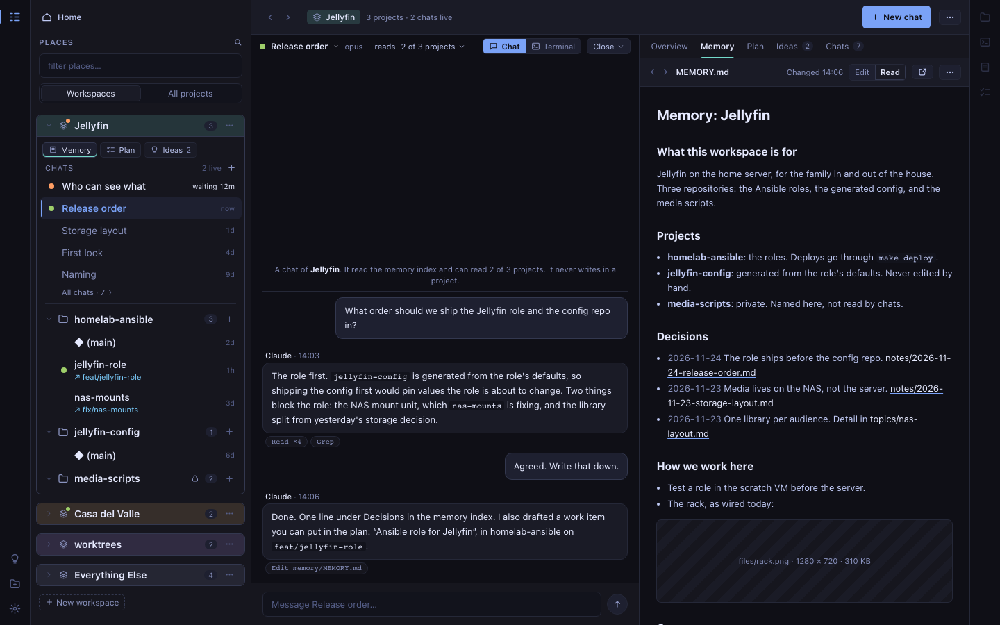
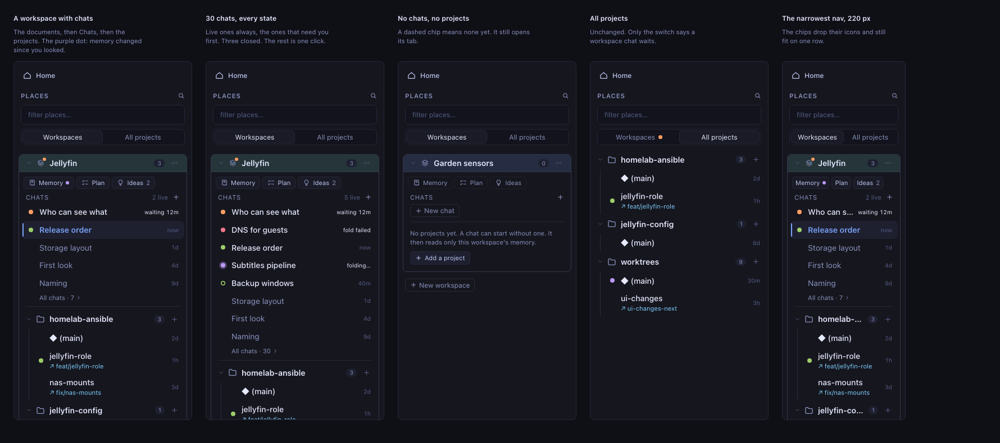
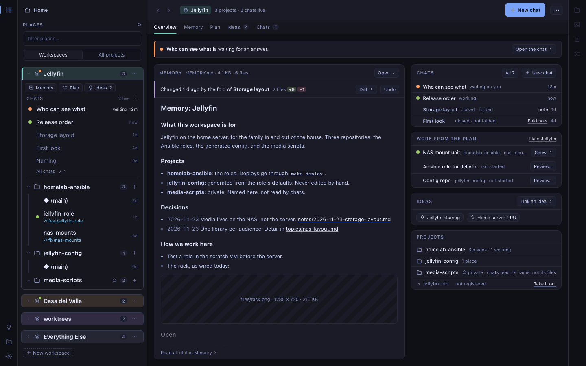
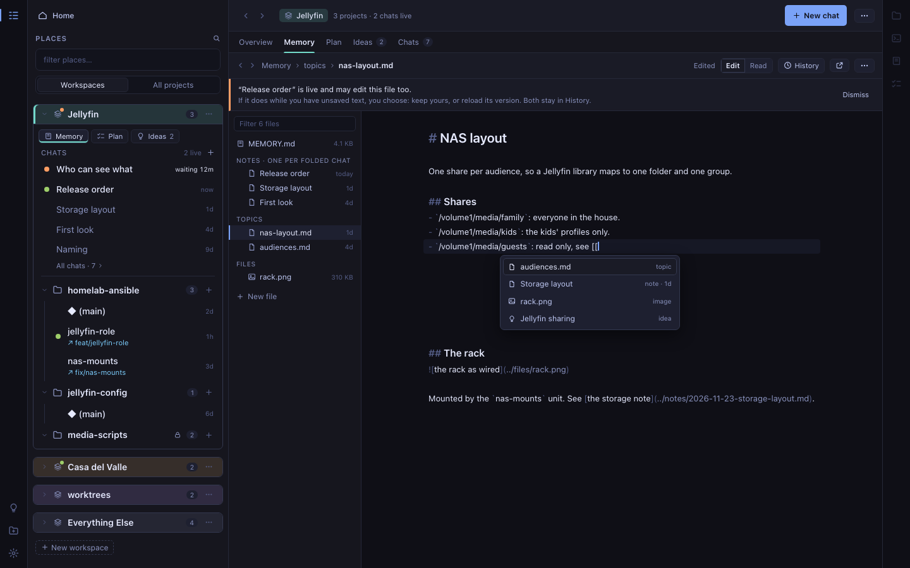
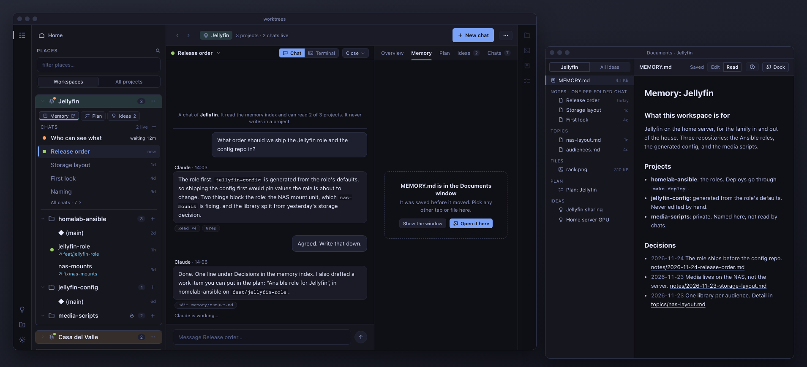
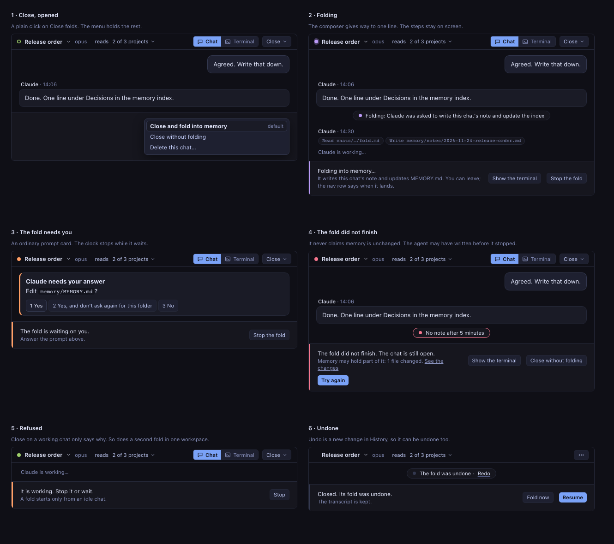
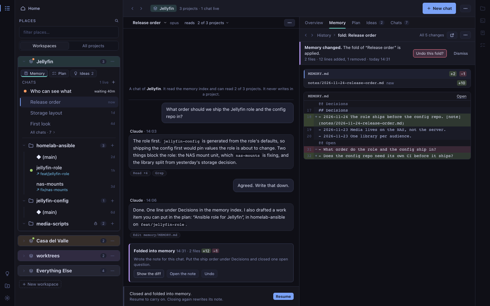
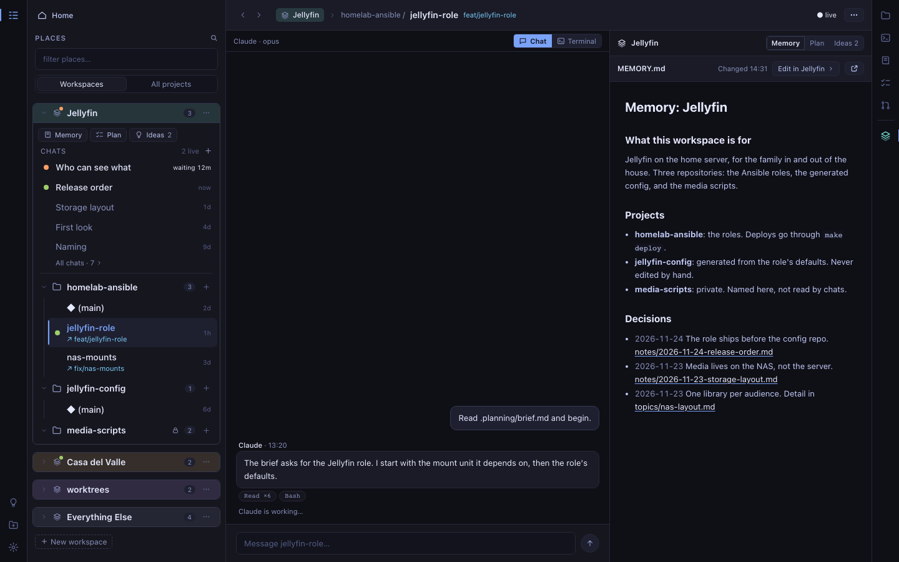
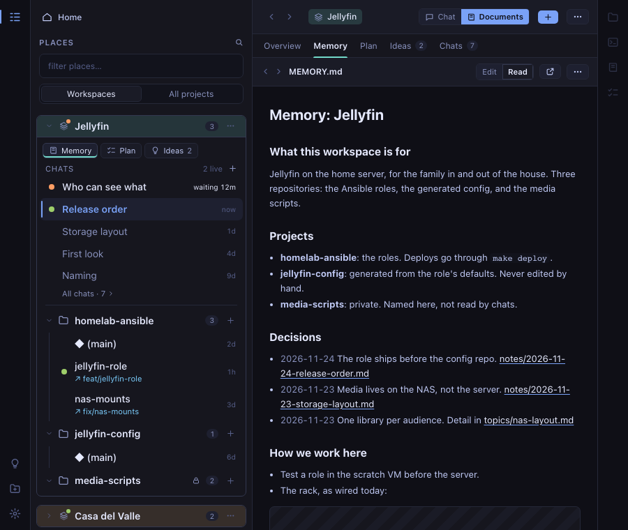

# The workspace view: the combined design

**Design, 2026-11-24. Nothing here is built, except the document pane it
stands on** (`feat/documents-in-main`, `76b981a`). It combines four independent
designs. [The critique](workspace-view-critique.html) says why each piece was
taken or left. The engine is [workspace chats](workspace-chats.html); §9 lists
what should change in it.

Marks: **checked** is read in the code. **measured** is run, in headless
Chromium and Playwright WebKit against the mock, or against the static mockups.
**guess** is neither.

## 0. The design, in one paragraph

A workspace becomes a workbench, with the same grammar as a place. In the nav,
its card gains one row of documents (Memory, Plan, Ideas) and a list of its
chats, above its projects. In the main area, a chat sits in the middle, where a
place's agent sits, and the documents sit on the dock side as five tabs:
Overview, Memory, Plan, Ideas, Chats. With no chat open the documents take the
whole room, and Overview shows what needs you, the memory itself, the chats, the
work and the projects. One document pane reads and edits all three kinds, and
moves to its own window when you float it. Close folds the chat. The fold is
shown in the chat as a receipt and beside it as a diff, with Undo. A place keeps
its workspace one click away, and can show its memory in the dock.



## 1. What I need from you

In order of weight. Each has my pick, so "as picked" is a full answer.

1. **Which side is the chat on?** My pick: the middle, with documents on the dock
   side. fable, codex and kimi. Against: your proposal's sketch, memdoor, and the
   Ideas window today, which has the document left and the chat right. Everything
   else works either way.
2. **"Visible when you click on the project": what is clicked?** My pick: you
   meant the workspace, and a *place* in it gets its workspace's documents in the
   dock (fable). A project's name keeps folding its places. The other reading: a
   project gets a page of its own (codex). That is a new screen, not drawn here.
3. **What does a workspace show first?** My pick: an Overview with the memory on
   it. fable and kimi; codex with counts only. Against: straight to the Memory tab
   (your proposal, memdoor).
4. **Float moves the document, or shows it twice?** My pick: it moves, and the
   main window shows where it went. fable, codex, kimi. Built today: it stays open
   and editable in both. There is no lock, and opening it in both stays possible.
5. **The lightbulb.** My pick: it keeps opening the Ideas window (fable, at first).
   codex and kimi open a library in the main window now. If you want that, it is
   slice 7.
6. **Three closed chats in the nav?** My pick: three (fable, memdoor). kimi: up to
   two. codex: none.
7. **Memory and plans open in Read, ideas open in Edit?** My pick: yes, and the
   last choice is remembered per kind. fable, codex and kimi: Read for all.
8. **One commit per editing session, not per save?** My pick: yes (fable). It
   changes the proposal's §2.5.
9. **One fold at a time in a workspace?** My pick: yes (codex). A second Close says
   "another chat is folding".
10. **The words.** "History" for all three kinds (fable, kimi), so the Ideas
    window's "Versions" changes. And the window's name: "Documents", once it shows
    memory. Mine.
11. **A dropped image is saved into `files/`**, with the proposal's 4 MB cap. My
    pick: yes, in slice 5. fable, kimi. It needs one new row.

## 2. The nav

**Recommendation: one row of documents and a Chats group inside the card, above
the projects. All projects changes by one dot.**



```
 ▾ ◈ Jellyfin                      3  ⋯
   [▤ Memory •] [☑ Plan] [✦ Ideas 2]        the documents
   CHATS                    2 live  +
   ◐ Who can see what     waiting 12m
   ● Release order               now
     Storage layout               1d        closed: dim, no dot
     First look                   4d
     Naming                       9d
     All chats · 7 ▸
   ─────────────────────────────────
   ▾ homelab-ansible              3  +      its projects, as today
```

**The documents.** A chip opens its tab. Memory wears a purple dot when it
changed since you looked. A dashed chip has nothing behind it and still opens
its tab. A floated document's chip wears the float mark. At the narrowest nav,
220 px, the chips drop their icons and still fit on one row (**measured**).

**A chat row** is one line: dot, title, age. When it needs you or is folding,
the age gains a word. The word is `--txt-hi`: in the light themes dim text is
too faint for something you must see (**measured**, 3.1 to 1 in Tokyo Night Day).

| State | Dot | The age column |
|---|---|---|
| waiting on you | amber | waiting 12m |
| fold failed | red | fold failed |
| working | green | age |
| folding | purple, a halo | folding… |
| open, idle | a green ring | age |
| closed | none, dim title | age |

That order is the order of the rows. All live chats show, then three closed,
then "All chats · N".

**Four things this touches that no design named** (**checked**):

- The card's dot is `busy` before `waiting` (`App.tsx:9440`). It becomes
  waiting first, here and in the two other places that compute it.
- Home is lit whenever no place is selected (`App.tsx:9740`). It must not be
  lit in a workspace.
- The filter box matches chat titles too, and Enter can land on a chat row.
- ⌘K lists chats and the three documents, under their workspace.

**All projects** is unchanged. A chat belongs to no project. The **Workspaces**
segment of the switch wears an amber dot while any workspace chat waits.
**Everything Else** has no documents and no chats: it is derived.

**A workspace with nothing** shows three dashed chips, New chat, and today's
"Add a project".

**The lightbulb** does not change in these slices. It is the way to ideas that
no workspace links.

Rejected: three rows (87 px a card against 30); no documents in the nav; a
Documents section in the rail; closed chats hidden.

## 3. The main area

**Recommendation: a top bar like a place's, then two sides. With no chat open,
the documents are the whole room.**

### 3.1 A workspace, no chat: Overview



```
 ‹ ›  ◈ Jellyfin   3 projects · 2 chats live                  [ + New chat ] ⋯
 ───────────────────────────────────────────────────────────────────────────────
 Overview   Memory   Plan   Ideas 2   Chats 7
 ┃ ◐ Who can see what is waiting for an answer.               Open the chat ▸
 ┌ MEMORY  MEMORY.md · 4.1 KB · 6 files   Open ┐ ┌ CHATS        All 7  New chat ┐
 │ ┃ Changed 1 d ago by Storage layout         │ │ ◐ Who can see what   waiting │
 │   2 files +9 −1            Diff ▸   Undo    │ │ ● Release order      working │
 │ # Memory: Jellyfin                          │ ├ WORK FROM THE PLAN ──────────┤
 │ …                                           │ │ ● NAS mount unit      Show ▸ │
 │                                             │ │   Config repo       Review…  │
 │                                             │ ├ IDEAS ───────────────────────┤
 │ Read all of it in Memory ▸                  │ ├ PROJECTS ────────────────────┤
 └─────────────────────────────────────────────┘ └──────────────────────────────┘
```

- **The line on top** shows only when something needs you: a waiting chat, a
  failed fold, a document with a conflict, a plan with problems.
- **Memory** is the wide column. It is the index as it reads, cut where the
  column ends, never in a scroller of its own.
- **The right column** is the chats, the plan's work, the ideas, the projects.
  Work keeps today's buttons. Everything today's overview does stays, here or
  on the Plan tab (Clone and Create go there, with the plan's projects).
- Under 900 px of room it is one column: chats first, memory last.

### 3.2 A chat open

```
 ‹ ›  ◈ Jellyfin   3 projects · 2 chats live                  [ + New chat ] ⋯
 ───────────────────────────────────────┬───────────────────────────────────────
 ● Release order ▾  opus  reads 2 of 3 ▾│ Overview  Memory  Plan  Ideas 2  Chats 7
           [Chat | Terminal]  [Close ▾] │ ‹ › MEMORY.md  Saved [Edit|Read] ⇱ ⋯
 ───────────────────────────────────────│───────────────────────────────────────
   the chat view                        │  # Memory: Jellyfin
                                        │  …
 [ Message Release order…            ⏎ ]│
```

- The documents keep their tab when you click another chat. Only the middle
  changes, as it does when you click another place.
- The documents side follows `dock_side` and has its own width. It starts at
  46 percent. It is not the dock: `fitLayout` is untouched.
- The **top bar** gives the workspace Back and Forward, which it lacks today
  (**measured**: no history buttons on the overview). Back learns workspaces,
  tabs and chats. `navHistory.ts`'s `Loc` holds a place or Home only
  (**checked**).

### 3.3 The tabs

| Tab | Holds | Empty |
|---|---|---|
| Overview | §3.1 | Never: it always has Projects |
| Memory | The pane on a file, the file list, History | "No memory yet. It starts with the first chat." New chat · Make memory |
| Plan | Projects and Work, then the plan in the pane | "No plan." Link a plan ▸ · Make a plan |
| Ideas | The linked ideas, and the one picked in the pane | "None linked." Link an idea ▸ |
| Chats | Every chat: state in words, dates, its note, its fold | "No chats yet." New chat |

One document is open at a time, as built. Changing tab leaves the open one, and
leaving saves it. If it cannot be saved, the tab does not change and its banner
says why. That is the pane's own `leave()`.

### 3.4 Review and Start

Unchanged. **Review…** opens today's review. Until the proposal's phase 4 a chat
drafts a work item in words and you paste it. No screen may suggest it can do
more.

Rejected: the documents on the left; a dashboard with no tabs; one tab bar with
the chat in it; three columns.

## 4. The document pane

**Recommendation: the pane that is built, with a smaller header, a way to start
in Read, and Float as a move.**



```
 ‹ ›  Memory ▸ topics ▸ nas-layout.md      Edited  [Edit|Read]  History  ⇱  ⋯
 ────────────────────────────────────────────────────────────────────────────
 │ Filter 6 files   │  # NAS layout
 │ ▤ MEMORY.md      │  - `/volume1/media/guests`: read only, see [[▌
 │ NOTES            │                ┌ audiences.md        topic ┐
 │   Release order  │                │ Storage layout       note │
 │ TOPICS           │                └ Jellyfin sharing     idea ┘
 │ ▸ nas-layout.md  │
 │ FILES            │
 │   rack.png       │
```

### 4.1 The header

The built one needs 378 px of tools. It is three rows tall at 340 px
(**measured**). New rule, by the pane's own width:

| Width | Shows |
|---|---|
| 640 and over | state, Edit \| Read, History, Float, ⋯ |
| under 640 | state, Edit \| Read, Float, ⋯ |
| under 420 | Edit \| Read, Float, ⋯ (state on hover; "Not saved" always shows) |

Back is gone: the tabs are the way back. Rename and Show in Finder are in ⋯.
The mockups hold this in one 41 px row down to 340 px (**measured**).

### 4.2 Read and Edit

Memory and plans open in Read. Ideas open in Edit. The last choice is kept per
kind. The editor is mounted on the first Edit. Today it is mounted always and
hidden in Read, so opening a document fetches it (**checked**, `EditorHost.tsx`).

### 4.3 Saving and conflicts

As built: it saves 800 ms after a pause, on blur, on leaving and on hiding.
"Keep mine" and "Reload theirs" stay. Two lines are added for memory:

- When a live chat could write the file you are editing: "“Release order” is
  live and may edit this file too." It does not block.
- When it did and you had nothing unsaved: "Changed by “Release order” · Diff".

A save is not a commit. The engine commits after a quiet minute, and before any
fold, chat start or Undo.

### 4.4 Links, images and files

- A relative link opens that file here, with `‹ ›`. A missing one is dim and
  says so. An `idea:` link opens the idea, on the Ideas tab.
- `[[` offers this memory's files first, then the linked ideas. It writes a plain
  markdown link.
- In Read an image is drawn. In Edit it is text. `files/` holds images with a
  preview; anything else is a name, a size and Show in Finder.
- The file list is a column at 720 px of pane, a **Files ▾** button under that.
  200 files fold by folder, and notes by month.

### 4.5 History

One button, three kinds. An idea or a plan has its versions, as today. Memory
has the folder's changes, filtered to the open file, with "All changes" beside.
Picking a change shows its files, and **one file's diff at a time**. A changed
image shows before and after. Each change has Undo, and an undone one has Redo.

### 4.6 Floating



```
 main                                     Documents
 ┌─────────────┬───────────────────────┐  ┌ Jellyfin | All ideas ─┬─ MEMORY.md ──┐
 │ the chat    │ MEMORY.md is in the   │  │ ▤ MEMORY.md           │ Saved  Dock  │
 │             │ Documents window      │  │ NOTES …               │ …            │
 │             │ Show · Open it here   │  │ PLAN · IDEAS          │              │
 └─────────────┴───────────────────────┘  └───────────────────────┴──────────────┘
```

- **⇱** saves, then closes the document here, then opens it there. If the save
  fails nothing moves.
- Main shows a card: **Show the window** · **Open it here**. Other tabs work. A
  save or a window that died never locks you out: the card is words, not a lock.
- The window is the Ideas window. Its list gains **Jellyfin | All ideas**, so a
  memory file has its neighbours. **Dock** saves and brings it back.
- One floated window, as today.

Opening it in both is allowed. Blur saves it (**measured**: 3 and 4 ms after the
blur), and a clean copy reloads when the other side saves.

Rejected: a lock between windows; two copies on purpose; a window per document.

## 5. The chat

**Recommendation: the place view's agent cell on a workspace chat. New: what it
reads, and what Close does.**

**Start.** `+` or New chat. The row appears at once. The first line says: "A chat
of Jellyfin. It read the memory index and can read 2 of 3 projects. It never
writes in a project." Claude's folder-trust question is an ordinary prompt card.
A refusal (limit, quota, no Claude) is said in the chat side, and the row goes.
Its title is "Chat 3" until your first message names it. No dialog.

**Header.** Dot, title and ▾ (the workspace's chats, Rename). "reads 2 of 3" lists
which. Chat | Terminal. **Close ▾**: a plain click folds; the menu has Close
without folding and Delete. Close is not a filled button: it ends something.

**The terminal** stays on when a fold relaunches the session. It attaches again.

**No slash commands, attachments or place images**, as an idea's chat has none
today. Pictures in memory are the documents' job.

### 5.1 The fold



| Moment | What you see |
|---|---|
| The chat is working | Nothing closes. "It is working. Stop it or wait." **Stop** |
| Another chat is folding | "“Subtitles pipeline” is folding. Close this one after." |
| Folding | The composer gives way to one line. The steps stay. **Show the terminal** · **Stop the fold** |
| It waits on you | A prompt card. The clock stops |
| It lands | §5.2 |
| Nothing to say | "No memory changes." The chat is closed |
| No note in five minutes | "The fold did not finish. The chat is still open. Memory may hold part of it: 1 file changed. See the changes." **Try again** · **Close without folding** |
| After a restart, not known yet | "Checking the fold…" |

It never says memory is unchanged unless the engine has looked. No percent, and
no promise of how long.

### 5.2 After it lands



```
   … Claude · 14:06  Done. One line under Decisions.      │ History ▸ fold: Release order
 ┃ Folded into memory  14:31 · 2 files  +12 −1            │ ┃ Memory changed.  [Undo] Dismiss
 ┃ Show the diff   Open the note   Undo                   │  MEMORY.md                 +2 −1
 ────────────────────────────────────────────────         │  notes/2026-11-24-…   new    +10
 Closed and folded into memory.            [Resume]       │  18 + - The role ships before…
```

- **A receipt ends the chat** and stays in its transcript for good.
- **The documents side shows the diff**, unless you are editing. Then only the
  purple dot appears.
- **Undo takes two presses.** It is a new change, so it has **Redo**. If later
  edits overlap it is refused whole: "MEMORY.md changed after it. Open History."
- A close without folding that left changes shows them the same way.

### 5.3 Ended chats

The transcript, read only, and one line: closed and folded; closed, not folded
(**Fold now**); its fold was undone (**Fold now**); its transcript is gone.
**Resume** on all but the last.

## 6. A project and a place inside a workspace

**Recommendation: the top bar names the workspace, and the dock gains one tab
with its documents, to read.**



```
 ‹ ›  [◈ Jellyfin] ▸ homelab-ansible / jellyfin-role              ● live  ⋯
 ────────────────────────────────────────┬──────────────────────────────────
  the place's agent                      │ ◈ Jellyfin    Memory | Plan | Ideas 2
                                         │ MEMORY.md       [Edit in Jellyfin ▸] ⇱
```

- Memory sits where it sits beside a chat. Going from one to the other, it does
  not move.
- The tab reads. **Edit in Jellyfin** opens the file in the workspace view, in
  Edit. Float works from here. The window has one open document, so one editor.
- Which workspace: the card you clicked in. From All projects: the only one that
  holds the project, or a picker if several do, or no crumb. So the selection
  carries its workspace. If the project leaves it, the place stays and the crumb
  goes.
- The crumb returns to where you were in the workspace.
- No workspace chat inside a place's view.

## 7. Small and odd cases

| Case | What happens |
|---|---|
| **1600 px**, nav pinned | Both sides: 645 and 549 at the mockup's nav |
| **1440 px**, nav pinned | 558 and 476 |
| **900 px**, nav unpinned (the default) | 472 and 340, as a place with its dock |
| **900 px**, nav pinned | One side, with **Chat \| Documents** in the top bar |
| The rule | Both from 760 px of room: 420 for the chat, 340 for documents |
| 30 chats | Three closed in the nav. The Chats tab filters and groups by month |
| 200 files | Folded, filtered. History 50 at a time |
| No memory | Dashed chip. Nothing else depends on it |
| Memory cannot be read | Its own words and Retry. Not "no memory" |
| A long index | "The index is long (23 KB). Every chat reads all of it." **Tidy…** |
| A private project | A lock in the nav; "chats read its name, not its files" |
| A project that left | "not registered", Take it out |
| Workspace removed | The notice names the folder it moved to, with Show in Finder |
| Ideas off, chats on | Overview, Memory, Chats. No Plan or Ideas tabs or chips |
| Chats off, Ideas on | Overview, Plan, Ideas. Better than today already |
| A guest's share, a paired device | Covered as a place is; sees none of it |
| Themes | Words are `--txt-hi` or `--txt`. Hue is a dot, an edge, a tint. Diff rows are mixed over the panel |



## 8. The slices

Each is one lane, leaves the app shippable, and is driven once in the sandbox
app with scratch workspace and ideas folders and its own tmux server.

| # | Slice | Needs | Checked in the real app |
|---|---|---|---|
| **0** | **Land the documents lane.** Then, small: the header of §4.1, Read first with the editor on first Edit, Float as a move | Built | Ideas and plans at 340, 484 and 1052 px in both windows. Float with a failing save: nothing moves. Float, quit the window from its menu, Open it here. Open in Read and see no editor chunk fetched |
| **1** | **The workbench.** Top bar, tabs, Overview, Plan and Ideas tabs on the pane, Back and Forward, the Home row, the documents row in the nav | 0. Ideas' flag | Every button of today's overview, at 900 and 1600, in six themes. Type in a plan, click a place, come back: saved. Make it unsavable first: it waits with its banner. Hit-test every control |
| **2E** | **Engine: a chat.** The folder, the record, launch, rows, `workspaces:sessions` with fold state in its shape | The proposal's phase 1. Measures `--add-dir` first | A chat started, answered and resumed from a loopback test client (every row is console only). A place's session list unchanged |
| **2** | **Chats on screen.** Nav rows, the dots and the rollup, the filter and ⌘K, the chat in the middle (`IdeaChat`'s parts moved out of the companion, a third target for `ChatPane`), Terminal, Close without folding, Resume, Delete, the Chats tab | 1, 2E. Its own flag | Two live chats with a draft in each. A waiting one under a workspace with a working lane: the card is amber. The trust prompt. The live-agent limit. Reload the app with both running |
| **3** | **Memory, read.** The chip, the tab, the file list, links, images, History and one change's diff | 2E's memory rows | A chat that writes a topic and an image. 200 files. A link out of the folder and a symlink, both refused |
| **4** | **The fold.** Close, the states, the receipt, the diff, Undo and Redo | 2, 3, the proposal's phase 2 with §9 | A real fold. One with a prompt left for six minutes. One stopped. One whose note is never written. **The same chat folded twice.** Two chats closed together. Undo after a hand edit to the same line, and with a live chat's unsaved change in the tree |
| **5** | **Memory, edited.** The memory source, `[[`, New file, a dropped image, the "may edit this too" line, the commit per session | 0, 3 | You and a chat in one file at once, both ways. Ten minutes of typing is one change in History. A 5 MB image is refused in words |
| **6** | **A place knows its workspace.** The crumb, the dock tab, the selection carrying its workspace | 3 | A project in two workspaces, from each card and from All projects. The dock on the left. Edit in Jellyfin, and Back |
| **7** | **The library in main.** Only on decision 5 | 0 | The Ideas window's browser checks, against both hosts |

- 0 and 1 are worth shipping alone. They answer "plenty of real estate" with no
  engine work.
- 2E can run beside 0 and 1. 3 can run beside 2. 5 and 6 can run together.
- Slices 1 and 2 both edit `App.tsx`'s nav. Not together.

**The one structural change.** The built document is the last child of `.main`,
mounted whatever is shown, so unsaved text survives a nav click. Keep that. The
workspace view becomes a frame in that spot: tabs on top, the chat in one column,
the pane in the other, hidden and not unmounted when a place is selected. The
pane's section keeps one parent for its life.

## 9. What should change in the proposal

I did not edit it. Surfaces:

- **§4.2**: add the documents row. Say waiting beats working on the card.
- **§4.3**: the chat in the middle; an Overview first; the tabs over the
  documents and not beside the chat's header; what Float leaves behind.
- **§4.1**: the built document is gated on Ideas alone. Memory must open without it.
- **§4.4**: a floated memory file needs a hand-off of its own. Today's accepts an
  idea's id only (**checked**, `plans.ts:335`).

Engine, each because a screen above needs it:

1. §5.5: `workspaces:sessions` carries each chat's fold state, and after a restart.
2. §5.5: `workspaces:memory` carries **paths and mtimes**. The pane cannot tell
   its own save from an agent's without them (**checked**, `ideasave.ts`).
3. §5.1: `chats.json` keeps last activity, the fold's result and the note's path.
4. §3.1: the engine names the note's path in `fold.md`.
5. §3.1: a fold ends on a note **newer than the fold's start**. "The note exists"
   is true at once the second time a chat folds.
6. §3.1: the five minutes stop while it waits on a prompt.
7. §3: one fold at a time in a workspace.
8. §2.5: one commit per editing session.
9. §3.2: Undo commits a dirty tree first, reverts, and on a conflict aborts and
   names the files. A revert can be reverted.
10. §3: Close without folding and Stop the fold commit what is left.
11. §1.2: `context.md` and the chat rows list what is not read.
12. §5.3: one more row, put a file under `files/`.

## 10. What I could not establish

- **Anything in the app's own WKWebView**, or with two real windows. The blur
  was measured in one page.
- **The mockups are static.** They hold their widths in both headless engines and
  share no code with the app. Where one and this text disagree, the text wins.
- **Contrast.** Measured on the mockups in six themes. The words that matter hold
  4 to 1 or better except dim metadata (3.1 to 1 in Tokyo Night Day) and ages
  (2.1 to 3.2), which are the app's own tokens and the same everywhere in it.
- **Overview with a full 16 KB index**, and whether the cut reads well.
- **Whether 46 percent is the right split** with real transcripts.
- **What a fold takes and costs.**
- **`--add-dir` and hooks**, the proposal's own first unknown. If it fails,
  "reads 2 of 3 projects" becomes "asks before it reads".
- **Whether one floated window is enough.**

## The mockups

In [`img/workspace-view/`](img/workspace-view/). Each HTML is self-contained, and
`?theme=` takes any of the six. The PNGs are Chromium, Tokyo Night and Tokyo Night
Day. All fourteen views were also rendered in WebKit, with the same widths and no
overflow; two of those are kept as `*.webkit.png`. The scaffold began as fable's
generator.

| Screen | HTML | Dark | Light | Other widths |
|---|---|---|---|---|
| Nav | [html](img/workspace-view/01-nav.html) | [png](img/workspace-view/01-nav.dark.png) | [png](img/workspace-view/01-nav.light.png) | |
| Overview, no chat | [html](img/workspace-view/02-overview.html) | [png](img/workspace-view/02-overview.dark.png) | [png](img/workspace-view/02-overview.light.png) | [900](img/workspace-view/02-overview-900.dark.png), [1600](img/workspace-view/02-overview-1600.dark.png) |
| A chat beside memory | [html](img/workspace-view/03-chat-and-memory.html) | [png](img/workspace-view/03-chat-and-memory.dark.png) | [png](img/workspace-view/03-chat-and-memory.light.png) | [900](img/workspace-view/03-chat-and-memory-900.dark.png), [1600](img/workspace-view/03-chat-and-memory-1600.dark.png) |
| A fold landed | [html](img/workspace-view/04-fold-landed.html) | [png](img/workspace-view/04-fold-landed.dark.png) | [png](img/workspace-view/04-fold-landed.light.png) | |
| Editing | [html](img/workspace-view/05-editing.html) | [png](img/workspace-view/05-editing.dark.png) | [png](img/workspace-view/05-editing.light.png) | |
| Floated | [html](img/workspace-view/06-floated.html) | [png](img/workspace-view/06-floated.dark.png) | [png](img/workspace-view/06-floated.light.png) | |
| The fold, state by state | [html](img/workspace-view/07-fold-states.html) | [png](img/workspace-view/07-fold-states.dark.png) | [png](img/workspace-view/07-fold-states.light.png) | |
| A place inside a workspace | [html](img/workspace-view/08-place-in-workspace.html) | [png](img/workspace-view/08-place-in-workspace.dark.png) | [png](img/workspace-view/08-place-in-workspace.light.png) | |
| 900 px, nav pinned | [chat](img/workspace-view/09-narrow-pinned-chat.html), [documents](img/workspace-view/09-narrow-pinned-docs.html) | [chat](img/workspace-view/09-narrow-pinned-chat.dark.png), [documents](img/workspace-view/09-narrow-pinned-docs.dark.png) | [chat](img/workspace-view/09-narrow-pinned-chat.light.png), [documents](img/workspace-view/09-narrow-pinned-docs.light.png) | |
