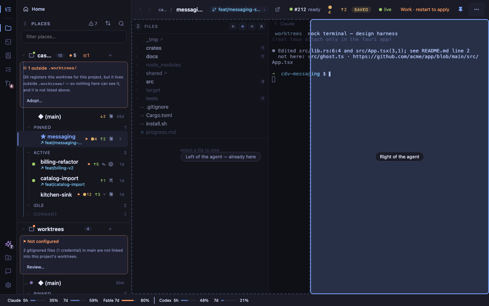

# Reference left, agent right — dock-side P1–P3

- **Date:** 2026-10-14 → 2026-10-15
- **Place:** `dock-side-mix` (`.worktrees/dock-side-mix`), orchestrated by `(main)`
- **Branches:** `dock-side-mix-p1`, `dock-side-mix-p2`, `dock-side-mix-p3` (all squash-merged, remotes deleted)
- **PRs:** [#490](https://github.com/penard-monkey/worktrees/pull/490) (P1, `228aba7`), [#494](https://github.com/penard-monkey/worktrees/pull/494) (P2, `0afa318`), [#495](https://github.com/penard-monkey/worktrees/pull/495) (P3, `8304e46`)
- **Release:** lands in v0.42.0 (not yet tagged)
- **Planning files:** none (the lane worked from `.planning/brief.md`); the design is archived here as [`proposal.md`](proposal.md). Its relative links to `mocks/` and the `dock-side-fable` / `dock-side-astra` places point at scratch that was not committed (mocks stay in `~/.cache/worktrees/worktrees/dock-side-mix/mocks/`; both places are removed).

## What shipped

The brief began as design + mocks only: synthesise two independent designs
(Fable's and Astra's) for putting the reference panels (Files/Docs/Plan) on the
left and the agent on the right. David approved building all three phases with
the proposal's §9 recommendations: phase 2 before 3, the lower slot holds the
Terminal only, keep the no-seed rule, no collapse control, tile named "Agent right".

**P1 — #490, the layout.**
- `dock_side` split off `places_side` (`app/src/settings.ts`, settings rev 4,
  `migrate` derives it `from < 4`). When places and reference share a side the
  two rails MERGE into one strip (`railsMerged`, `railsWidth`).
- Settings → Navigation → **Layout**: four tiles — Classic / Agent right /
  Mirrored / Agent left.
- The nav's hover overlay (`.float-stack`) anchors over the agent when the
  rails merge (`leftOfMain`).
- `.app`'s grid row bounded to `minmax(0,1fr)` and the merged rail's groups
  scroll (`.rail-group`), so page zoom cannot push the strip off-screen.
- `app/scripts/layout-check.mjs` (the layout's mirror and grid checks).

**P2 — #494, the Terminal below the reference panel.**
- `dock_lower` / `dock_lower_frac`: the dock's Terminal can live in a lower
  slot under Files/Docs/Plan — the SAME shells, not a second instance.
- The splitter clamps through `lowerRange(h)` / `lowerFracFor`; `lowerFits(h)`
  falls back to a tab on a short window. Height comes from `.space-body`.
- The slot exists only while the session is up; `filesDockShown` keys on the
  shown tab. ⌘J on a too-narrow window explains itself (CHANGELOG `### Changed`).

**P3 — #495, drag to arrange.**
- Grips on Places (`.nav-head`), the reference panels (`.dock-tabs`), the agent
  (`.agent-label`) and the lower Terminal. Dragging paints zones
  (`ArrangeOverlay`); **nothing moves until the drop**, which is ONE settings
  write. `app/src/arrange.ts` is pure: every destination is a patch over
  `places_side` / `dock_side` / `dock_lower`, so a drag can produce nothing the
  Settings tiles cannot.
- Keyboard: the grip is a button; click/Enter opens a **Move…** `CtxMenu`. Esc
  cancels a drag via `useEscape`. Every move gets Undo + an `aria-live` line;
  **Reset layout** in Settings carries its own inline Undo.
- `app/scripts/arrange-browser.mjs` (Chromium + WebKit, real pointer input,
  counts `term_resize` at the mock bridge) and layout-check §6 (drives the real
  arrange block under stubs). termresize-check gained case 8.

## Decisions

- **No live reflow during a drag.** Every distinct grid handed to the pty is a
  SIGWINCH (AGENTS.md); a drop is one resize, a live preview would be dozens.
- **No reordering inside a column** — it would re-parent an xterm.
- **Lower slot holds the Terminal only.** Files/Docs/Plan each own state and
  polls; doubling them is a separate design.
- **Merged rail when places and reference share a side** (Fable's idea, with
  Astra's grouping) — two thin rails side by side read as a bug.
- **A drag's agent grip writes the reference side, inverted** — the agent has
  no field of its own; it is wherever the reference panels are not.
- **The downgrade round trip was left as is** (review item 7 on #490): only
  bites after a v0.41 downgrade; parked in ROADMAP with the fix shape.

## Dead ends / gotchas

- **`term_resize` writes nothing to app.log**, so "one SIGWINCH per flip" cannot
  be read off the log. The real-app check counts at tmux instead (procedure
  below). The mock harness counts at its bridge (`arrange-browser.mjs`).
- **A source-grep check passed against both review mutations.** The first
  layout-check §6 asserted the code *contained* pointer capture and no write in
  `onPointerMove`; review showed commenting out the capture, or adding a
  `useEffect(…updateSettings…, [arrange?.hover])`, left it green. Rewritten to
  drive the real block under re-rendering stubs (0 writes over 8 moves, 1 on
  the drop) and shown red on both.
- **Reset's Undo was unreachable**: the app's Undo banner sits under the
  Settings scrim. `commitLayout` now returns the undo and takes
  `banner: false`; the sheet shows its own. Found by `elementFromPoint`, not
  by the rect.
- **The mock's short tab names hid the grip overlap.** With them `+` cleared the
  lower Terminal's grip even without the fix; only asserting the strip's
  CONTENT box ends left of the grip (669 vs 677; 695 unfixed) goes red.
- **A drop that unmounts its own grip** (Terminal → tab) left the
  click-suppression flag set, swallowing the next grip click. The flag now
  clears on the next task; Esc-then-release has its own flag.
- **Synthetic pointer dispatch bypasses hit-testing** — the browser gate uses
  Playwright's mouse so the overlay and xterm are really under the pointer.
- **Harness quirks, reproduced on main, not ours:** xterm
  `Viewport.syncScrollArea` "dimensions" TypeError on place select; the mock's
  `__TAURI_EVENT_PLUGIN_INTERNALS__.unregisterListener` error on Terminal-tab
  unmount. The probes filter both.
- HMR is dead inside `.worktrees/` (AGENTS.md) — every edit needed a restart /
  served-content check on port 1477.

## Verification

- Per PR: tsc, all `app/scripts/*-check.mjs` from the repo root, the cargo/bats
  gates through `worktrees run --slot gate`, and full CI green (9 jobs) on each.
- Mock harness probes in Chromium + WebKit: layout-probe (104 assertions, P1),
  lower-probe (P2), arrange-browser (P3: 0 `term_resize` during a drag, 1 on
  the drop).
- Fable review before each merge; every finding fixed or explicitly left
  (downgrade round trip).
- **Real app:** David ran the flip + drag check by hand in
  `sandbox.sh --app` after #495 merged; the app behaved. Procedure, for the
  next time the grid changes:
  hook the place's session (`sbx-<branch>-<slug>`) with
  `tmux set-hook -t <session> client-resized 'run-shell "echo #{client_width}x#{client_height} >> /tmp/wt-flip.log"'`;
  flip Classic → Agent right → Classic → Mirrored → Classic → Agent left →
  Classic and expect 1, 1, 0, 0, 1, 1 new lines (nav pinned, then auto-hide);
  check `.main .term-host`'s right edge does not pass `.dock`'s left; drag each
  grip once (nothing during a drag, ≤ 1 line per drop) and, in Agent right on
  auto-hide, drag a place row from the revealed nav into the agent. Unhook with
  `tmux set-hook -u -t <session> client-resized`.

## Follow-ups

- Downgrade round trip (ROADMAP).
- Other sections in the lower slot, and a collapse control — both declined for
  now by decision, not deferred work.
