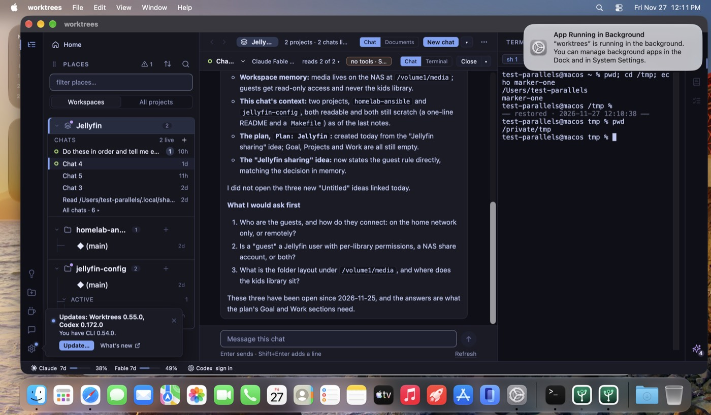

# The dock's Terminal in a workspace's view (#721)

- **Date:** 2026-11-27
- **Place:** `terminal-while-in-chat`
- **Branches:** `terminal-while-in-chat` (merged), `files-viewer-editor` (a lane this place started; investigated, built nothing, removed)
- **PR:** [#721](https://github.com/penard-monkey/worktrees/pull/721), squash-merged as `26c6d15e`
- **Release:** none; lands in the next one (`[Unreleased]` in CHANGELOG.md)
- **Planning files:** `planning.tar.gz` holds the `files-viewer-editor` lane's brief and findings. This place kept none.

## What shipped

The owner's ask: "when in the chat view I think the terminal should work. It
should always be at the ~/ directory and new tab created would also be in ~/.
And they should be remembered like the other ones."

In a workspace's view the right rail's Terminal icon now opens the dock with
shells in the home directory. One strip of tabs per workspace, remembered like a
place's: tabs, names, the front tab, each tab's last directory, scrollback and
per-tab history. Files, Docs, Plan and PRs stay disabled there.

- `crates/worktrees-api/src/term.rs`: `WORKSPACE_SCOPE = "~"`. A workspace's
  shell key is `("~", <workspace id>, index)`, so one registry and the same
  rows serve it. `shell_start` replaces `place_session_cwd` at the spawn site
  (home directory, no tmux session, refused unless `workspaces.json` lists the
  id). `forget_shell_scope`, and `scope_dir` for the two startup sweeps.
- `crates/worktrees-api/src/workspaces.rs`: removing a workspace kills its
  shells and forgets their directories and history.
- `crates/worktrees-cli/src/serve/resolve.rs`: `Obj::ShellScope`. The `~` scope
  is the console's alone; a device gets the refusal an out-of-scope place gets,
  before `workspaces.json` is read. `Obj::Shell`, `Obj::ShellRef` and
  `list_shell_sessions` go through it.
- `crates/worktrees-cli/src/serve/scope.rs`: `shell:exit` is `Event::Shell`; a
  workspace's exit reaches no device.
- `app/src/wsdock.ts` (new) holds the frontend rule; `App.tsx` renders
  `<aside class="dock" data-testid="ws-dock">` beside the `WorkspaceFrame`, with
  its own `place_panels["~|<id>"]` record. `app/scripts/wsdock-check.mjs` (new)
  and new sections in `placeview-check.mjs` and `layout-check.mjs`.

## Decisions

- **One strip per workspace**, not global and not per chat: "remembered like
  the other ones" means like a place, and a chat comes and goes.
- **Starts in `~`, then remembers.** A new tab opens at home; a restored tab
  reopens where it was, falling back to home. The owner accepted this reading.
- **A reserved scope, not six new rows.** The command names are load-bearing in
  lanes, audit, budget, step-up and frames. A `repo` that can never be a path
  leaves all of that alone, and the security rule is one check in the resolver.
- **Console only**, like every workspace row: the shell starts in the host's
  home directory.
- **The Files viewer stays a viewer** (owner, 2026-11-27: "let's not become a
  real editor yet. I don't know if it is worth it"). The lane measured that
  swapping the markdown textarea for the ideas editor costs about two days for
  one file type, and that editing other file types needs language packages and
  a find story. See Follow-ups for what it found on the way.
- **Where the terminal is drawn is the design lane's.** The owner found the
  switch jarring (below) and put `design-simplify-what-to-hide` in charge of
  the whole app's layout. #721 merged as built; the plumbing does not depend on
  the placement.

## Dead ends / gotchas

- **Opening the dock collapses the workspace frame on a mid-size window.** The
  frame picks one or two columns from its own width
  (`WorkspaceFrame.tsx`, the ResizeObserver). At about 1365 points the 360px
  dock pushes it to one column: the Overview/Memory side vanishes and a
  "Chat | Documents" switch appears, for a click that asked for a terminal. The
  header then also holds two things named Terminal. Not seen in the mock at
  1280 or 1728 because nobody looked for the column count, only for overflow.
  The design lane's proposal (`docs/proposals/simplify-what-to-hide.md`
  on its branch `design/simplify-what-to-hide`, not on main at this writing;
  option E) makes the terminal one of the frame's side tabs.
- **Both sweeps would have deleted a workspace's tabs on every launch.**
  `forget_vanished_places` and `sweep_term_history` judged each stored key with
  `Project::discover(repo)`, which fails for `~`. Any new shell scope has to be
  taught to both. This was the brief's predicted bug and it was real.
- **`shell:exit` leaked to a `"*"` device.** `Event::ByPath` answers a device
  whose scope is everything before it looks at the path. Harmless for places
  (they are in scope), wrong for a scope that is no project.
- **"All 107 checks exit 0" was false, and CI caught it.** `layout-check.mjs`
  slices `App.tsx` up to the line `const shownTab = upperTab(`; the branch had
  wrapped that line, and the check died with a ReferenceError. The
  implementer's loop reported the pipeline's status, not the check's (the
  AGENTS.md "a pipeline's exit status is the LAST stage's" trap), and my own
  spot check ran only the two new checks. The first CI run on #721 went red on
  both app jobs. Fixed by leaving the sliced lines as they were: a workspace's
  `eff.dock_tab` is already its Terminal, so the wrap was redundant. Lesson for
  a review: run every `*-check.mjs` by exit code yourself when `App.tsx` moved.

## Verification

- Local gates by the implementer: release build, bats (613), lint, core (1434),
  cli (634), api (404), app lib (56), tsc, `cargo check --workspace
  --all-targets`. New Rust tests each shown red first by breaking the rule
  they guard. I re-ran the new tests, the two dock checks and tsc before the
  first push, and every frontend check by exit code after the fix.
- Mock harness, Chromium and Playwright WebKit, at 1280 and 1728: open, ⌘T,
  rename, ⌘F, switch to a place and back, ⌘J, reload, remove the workspace.
- The real app, built from the branch and run in the macOS test VM against its
  existing workspace: a login shell at `~`; ⌘T also at `~`; after quit and
  relaunch the same chat, dock, both tabs and front tab; the tab that had run
  `cd /tmp` reopened in `/tmp` with its scrollback under the restored seam; a
  place kept its own dock; no panic in app.log or serve.log. Not driven there:
  a tab rename, removing a workspace, a paired device's refusal.
- CI: second run green on all nine jobs before the merge.

## Follow-ups

In ROADMAP.md:

- The Files viewer rewrites a CRLF markdown file to LF on save (measured), with
  the lane's 15-line fix sketched.
- Three older `read_file` / `write_file` problems the lane found.
- The workspace terminal's gaps: no path links, lost ⌘J before settings load,
  not in a remote window, the cramped header.

Proposed for AGENTS.md, not written (needs the owner's yes):

- "A sweep that judges a `repo|slug` key with `Project::discover` must know the
  workspace scope (`term::WORKSPACE_SCOPE`), or a workspace's terminal is
  forgotten on every launch."
- "`layout-check.mjs` slices `App.tsx` between `const lowerSet` and
  `const shownTab = upperTab(`; change either line and it dies with a
  ReferenceError, which a piped loop reports as a pass."
